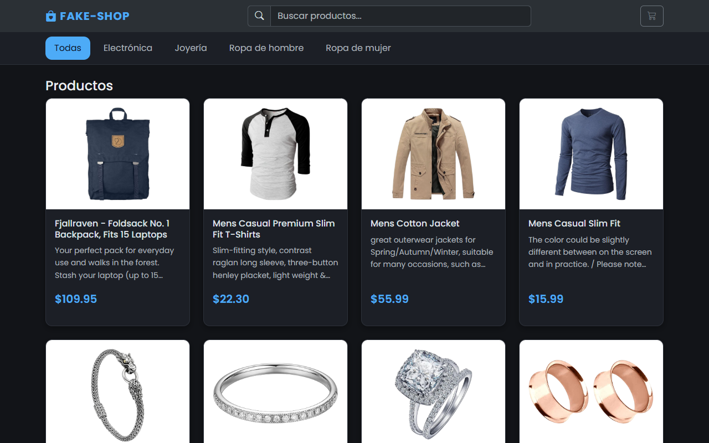
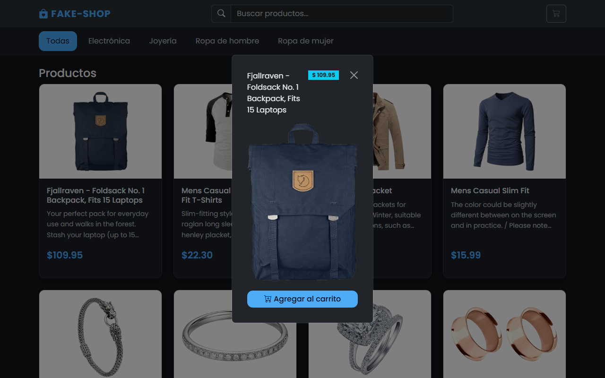
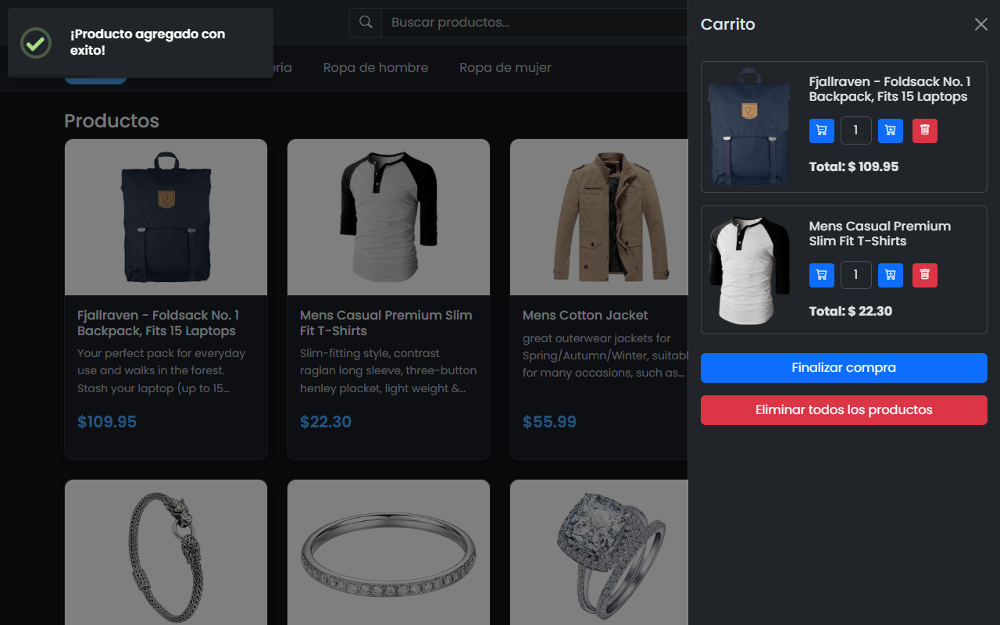
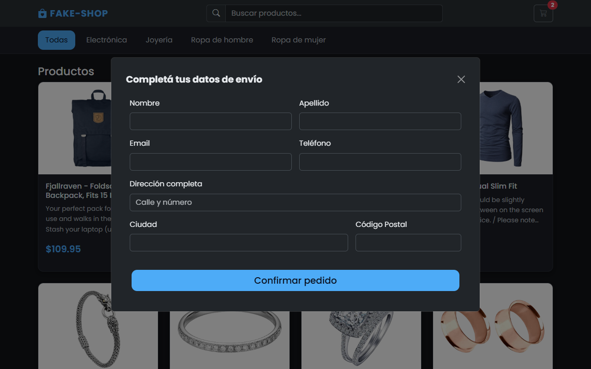

# FAKE-SHOP

Aplicación web cliente de e-commerce en modo oscuro que consume productos desde la [Fake Store API](https://fakestoreapi.com/) e implementa catálogo interactivo, filtrado, carrito persistente y flujo de checkout.

## Tech Stack

- **HTML5**: Estructura semántica con atributos de accesibilidad (`aria-*`, `role`) y tema oscuro (`data-bs-theme="dark"`).
- **CSS3**: Variables CSS personalizadas, diseño responsive y tipografía **Poppins** (Google Fonts).
- **JavaScript (ES6+ Modules)**: Código modularizado en `src/` (`api.js`, `index.js`, `ui.js`, `modal.js`, `cart.js`, `checkout.js`).
- **Bootstrap 5.3.3 & Bootstrap Icons 1.11.3**: Grilla responsive, barra de navegación, pills de categorías, modales, offcanvas del carrito y validación de formularios.
- **SweetAlert2 11.14.5**: Notificaciones *toast* al agregar productos, alertas de error con reintento y confirmación de compra.
- **Fake Store API**: Fuente externa de productos y categorías (`https://fakestoreapi.com/products`).
- **Web APIs**: `localStorage` para persistir el carrito y `History API` (`pushState` / `popstate`) para sincronizar la categoría seleccionada en la URL (`?category=...`).

## Funcionalidades

- **Catálogo de productos**: Carga asíncrona desde la API con indicador de carga (*spinner*) y manejo de errores con opción de reintentar.
- **Búsqueda y filtro por categorías**: Búsqueda en tiempo real por título o categoría (insensible a mayúsculas y tildes) combinada con navegación por categorías sincronizada con la URL.
- **Detalle de producto**: Modal interactivo al hacer clic (o presionar `Enter` / `Espacio`) sobre una tarjeta, con imagen, título, precio y botón para agregar al carrito.
- **Carrito de compras**: Panel lateral (*offcanvas*) con contador dinámico en la barra superior, ajuste de cantidades (`+` / `-`), eliminación individual o vaciado completo, y persistencia automática en `localStorage`.
- **Checkout**: Formulario de envío con validación nativa de Bootstrap (`nombre`, `apellido`, `email`, `teléfono`, `dirección`, `ciudad`, `código postal`) y modal de confirmación que vacía el carrito al finalizar.

## Capturas de pantalla

### Catálogo y filtros


### Detalle de producto


### Carrito lateral


### Formulario de checkout


## Cómo correr el proyecto

### Opción 1: Live Server (VS Code)

1. Instalar la extensión **Live Server** (Ritwick Dey).
2. Clic derecho sobre `index.html` → **Open with Live Server**.
3. Se abre en `http://127.0.0.1:5500`.

### Opción 2: Terminal

Con [Node.js](https://nodejs.org/) instalado, desde la carpeta del proyecto:

```bash
npx serve .
```

Abrir la URL que aparece en la terminal (normalmente `http://localhost:3000`).
